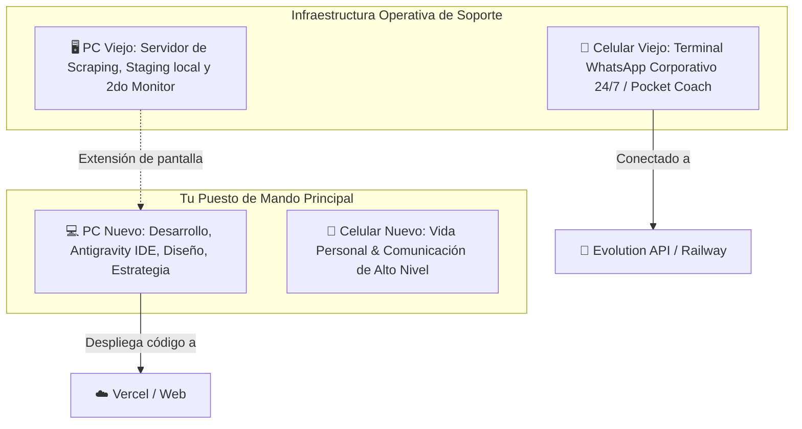

# 🚨 LinguaLife 2.0: Estado de Situación & Sprint Crítico de Lanzamiento
**Fecha:** Septiembre 2026  
**Fase:** Beta con Estudiantes Antiguos → Conversión & Lanzamiento Comercial (Fase Crítica)  
**Objetivo Prioritario:** Validar feedback de la beta, cerrar ventas, generar flujo de caja inmediato y asentar bases legales mínimas.

---

## 🧭 1. Radiografía Actual del Proyecto

| Eje | Estado | Situación Actual | Prioridad Inmediata |
| :--- | :---: | :--- | :--- |
| **Repositorio & Dev** | 🟢 Estable | Código sincronizado en nuevo PC, Node/Git configurados, `.env.local` blindado en `.gitignore`. | Pruebas locales y despliegue continuo. |
| **Plataforma Web (`apps/web`)** | 🟡 En Validación | Dashboard de Alumno (`/student`), Profesor (`/dashboard`), Admin (`/admin`) y Classroom listos con Next.js 16 + Supabase/Airtable. | Verificar que los flujos no revienten con estudiantes reales. |
| **Pocket Coach (WhatsApp)** | 🟡 Operativo / En prueba | Instancia `PocketCoach` en Evolution API (Railway/Cloud) + Gemini AI enviando micro-retos LDS. | Vincular al celular antiguo con la SIM corporativa fija. |
| **Beta Estudiantes Antiguos** | 🚀 Activa | Alumnos antiguos con acceso para testear funciones y dar feedback pedagógico/técnico. | Recoger fricciones, testimonios y compromiso de pago/reenganche. |
| **Monetización & Marketing** | 🔴 Crítico | No hay campaña activa ni embudo de ventas abierto a nuevos prospectos. | Diseñar oferta irresistible y lanzamiento de captación rápida. |
| **Marco Legal & Operativo** | 🟡 Pendiente | Contratos informales o pendientes de formalización educativa / términos de servicio. | Términos de servicio, Habeas Data (WhatsApp) y contrato de adhesión/matrícula. |

---

## ⚡ 2. Plan de Acción Inmediato (Sprint de Supervivencia y Conversión)

### 🎯 Bloque 1: Producto & Estabilización Rápida (Días 1 a 3)
1. **Atender feedback de la beta:**
   - Lista corta de bugs críticos detectados por los alumnos antiguos (login con PIN, visualización de clases, reposición de tokens).
   - No añadir "features nuevas complejas": solo asegurar que lo que ya existe funcione suave como mantequilla.
2. **Afianzar el Pocket Coach en el Celular Dedicado:**
   - Montar el WhatsApp de la SIM corporativa en el celular antiguo para que los retos diarios salgan de forma impecable sin mezclar tus chats personales.

### 💰 Bloque 2: Marketing & Oferta de Lanzamiento Rápido (Días 3 a 7)
1. **Oferta "Fundadores / Re-apertura":**
   - Paquete especial para estudiantes antiguos que recomienden a 1 amigo (descuento cruzado o mes bonificado).
   - Planes sencillos (ej. Plan Mensual Individual con Pocket Coach 24/7 + 2 clases en vivo semanales).
2. **Campaña mínima viable de captación (Low Budget):**
   - Contenido orgánico en TikTok / Instagram Reels mostrando el Pocket Coach en WhatsApp (la promesa: *"Una academia donde tu profe de IA te manda retos diarios al WhatsApp"*).
   - Enlace directo a WhatsApp corporativo automatizado con Evolution API para cualificar y agendar clase muestra o cierre directo.

### ⚖️ Bloque 3: Blindaje Legal Mínimo Viable (Legaltech Lean)
1. **Términos del Servicio y Política de Datos (Habeas Data):**
   - Vital al interactuar por WhatsApp y recolectar números de teléfono y grabaciones de clase.
2. **Contrato de Prestación de Servicios Educativos / Matrícula:**
   - Cláusulas claras de:
     - No reembolso una vez iniciado el mes / periodo.
     - Política de inasistencias y reagendamiento (máximo 24h previas, canje de tokens).
     - Propiedad intelectual del método y materiales.
3. **Ruta hacia la Oficialización:**
   - Fase 1 (Ahora): Persona Natural con Actividad Comercial / Régimen Simple (facturación electrónica si aplica).
   - Fase 2 (+50 alumnos): Creación de S.A.S. educativa y trámite de registro ante Secretaría de Educación (Educación Informal / Educación para el Trabajo y Desarrollo Humano).

---

## 🛠️ 3. Asignación de Roles de Hardware (Ecosistema Óptimo)

---

## 📌 4. Definición del Siguiente Paso
¿Qué pantalla o función de la web reportó problemas con los alumnos beta, o en cuál nos enfocamos ahora para dejarla al 100%?
