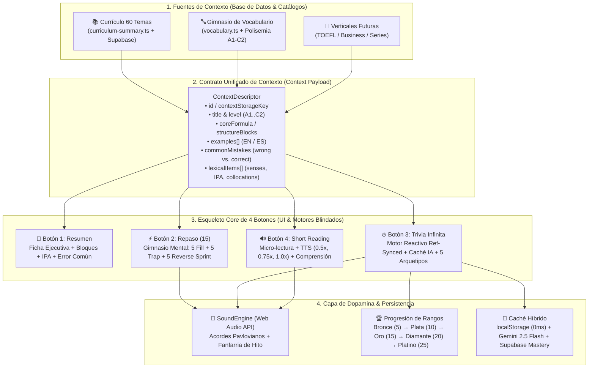
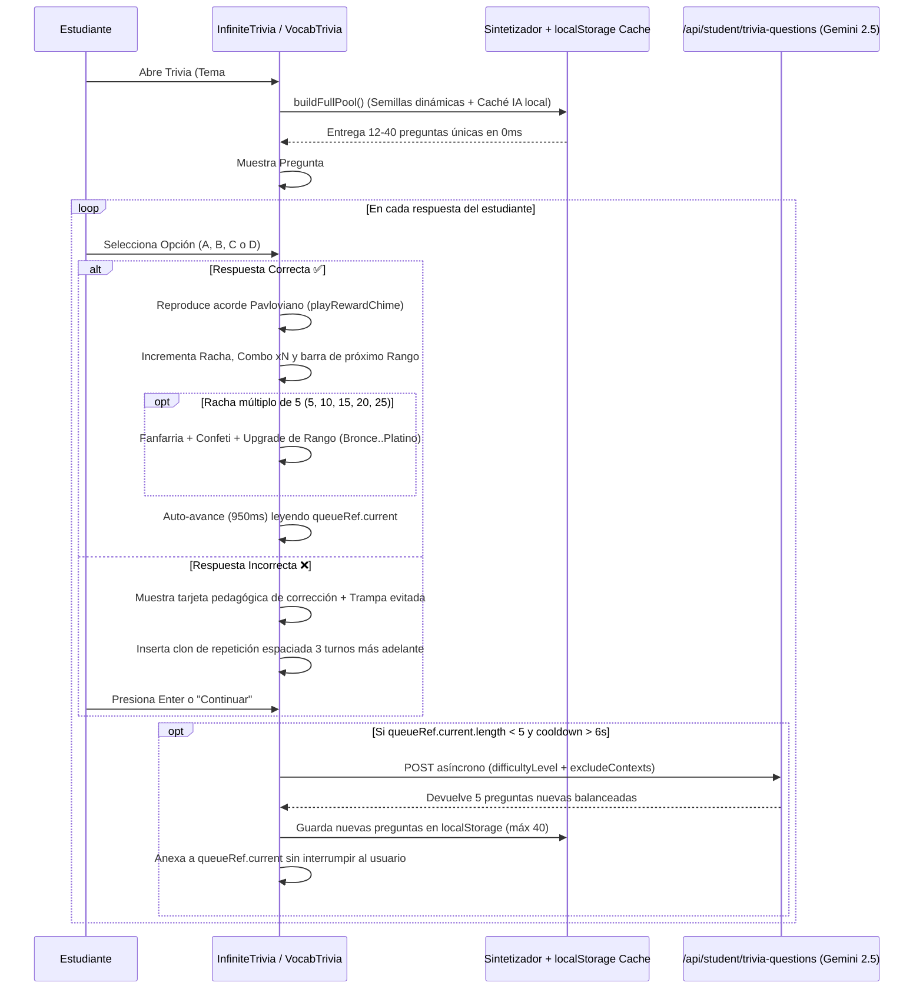

# Arquitectura Técnica Replicable: Sistema Core de 4 Botones & Motor de Trivia Infinita

> **Documento de Ingeniería & Producto — LinguaLife MVP**
> Este documento define el **esqueleto técnico blindado y replicable** que impulsa las 4 actividades centrales de práctica del estudiante (**1. Resumen**, **2. Repaso**, **3. Trivia Infinita** y **4. Short Reading**), tanto en los **Temas del Currículo (`/student`)** como en el **Gimnasio de Vocabulario (`/student/vocabulary`)** y cualquier vertical futura (TOEFL, Business, Medical, Series).

---

## 1. Visión Arquitectónica: "Un Solo Motor, Múltiples Fuentes de Contexto"

El sistema está diseñado bajo el patrón **Context-Agnostic Practice Engine (Motor de Práctica Agnóstico al Contexto)**. La interfaz de usuario, las mecánicas de dopamina, los niveles de dificultad, el audio y el bucle infinito son **un único esqueleto blindado**, mientras que el contenido se inyecta mediante **Adaptadores de Contexto (`ContextSourceAdapter`)** desde la base de datos o los catálogos pedagógicos.

---

## 2. Diagnóstico Raíz: ¿Por qué se congelaba la Trivia en la misma pregunta y cómo se blindó?

Durante la auditoría forense del código de la Trivia se identificaron y corrigieron **5 causas raíz** que provocaban que a algunos alumnos se les quedara congelada la misma pregunta:

| # | Causa Raíz Detectada | Impacto en el Estudiante | Solución de Blindaje Implementada |
| :--- | :--- | :--- | :--- |
| **1** | **Cierre obsoleto (`Stale Closure`) en el `setTimeout` de auto-avance (950 ms)** | Al acertar una pregunta, `setTimeout(() => handleNext(), 950)` capturaba la función `handleNext` ligada al array `queue` viejo. Si la IA terminaba de recargar preguntas durante esos 950 ms, el timer sobrescribía `queue` con el array vacío antiguo, borrando las preguntas nuevas. | Sincronización mediante `queueRef`, `currentQuestionRef` y `seenQuestionsRef` (`useRef`). `handleNext` y `refillQuestions` leen y mutan la referencia en tiempo real sin perder jamás preguntas recibidas en segundo plano. |
| **2** | **`remainingQueue.shift()` cuando `nonDupIndex === -1`** | Cuando el alumno fallaba una pregunta, esta se reinsertaba en la cola (repetición espaciada). Si la cola quedaba con esa única pregunta, `nonDupIndex` daba `-1` y el `else` hacía `remainingQueue.shift()`, volviendo a mostrar **exactamente la misma pregunta**. | Se prohibió que `handleNext` seleccione una pregunta con el mismo texto normalizado (`normalizeQuestionKey`) que `currentQuestionRef.current`. Si la cola solo tiene duplicados, se limpia y se invoca `getGuaranteedDifferentQuestion()`. |
| **3** | **Banco semilla limitado a 8 temas (2–3 preguntas por tema)** | Los otros 52 temas caían en 3 preguntas genéricas en español; si la llamada a la IA demoraba o fallaba, la rotación de 3 preguntas parecía estancada. | Nuevo **Sintetizador Dinámico (`trivia-seed.ts`)** conectado a `CURRICULUM_SUMMARY_CATALOG` y `VOCABULARY_MASTER_DATA` que genera **10 a 24 preguntas únicas** para cada uno de los 60 temas y cada nivel MCER (A1–C2) en 0 ms. |
| **4** | **Modelos Gemini antiguos y `JSON.parse` sin extracción segura** | `trivia-questions.ts` invocaba `gemini-1.5-flash` (deprecado) y hacía `JSON.parse` directo; cualquier bloque markdown extra devolvía HTTP 500. | Actualizado a `['gemini-2.5-flash', 'gemini-2.5-flash-lite', 'gemini-2.0-flash']` con extracción regex `rawText.match(/\{[\s\S]*\}/)`, `try/catch` local, balanceo de `correctIndex` (0..3) y fallback automático al sintetizador. |
| **5** | **`VocabularyTrivia.tsx` era estático (solo 3 preguntas fijas)** | En el módulo de vocabulario, la trivia terminaba a la 3ra pregunta, ignoraba las palabras de niveles A2–C2 y no tenía IA ni bucle infinito. | Reconstruido con el mismo motor infinito (`queueRef`, `seenQuestionsRef`, `getSeedQuestionsForVocabulary`, recarga IA con `contextType: 'vocabulary'` y caché persistente en `localStorage`). |

---

## 3. Especificación de los 4 Botones Core (Contrato Replicable)

Cada módulo de aprendizaje en LinguaLife expone exactamente las mismas **4 modalidades complementarias** para atacar las 4 rutas neurológicas de adquisición del idioma:

### Botón 1: `1. Resumen` (Decodificación Visual & Lógica)
* **Objetivo Cognitivo:** Comprender la fórmula estructural sin teoría gramatical pesada.
* **Componentes UI:**
  * Temas: `curriculum-summary.ts` renderizado en el modal de diapositiva única (`student.tsx`).
  * Vocabulario: `VocabResumenModal.tsx` con comparación de Acepción #1 vs. Acepción #2 (polisemia), pronunciación IPA y colocaciones.
* **Datos de Entrada:** `concept`, `correctMethod`, `structureBlocks[]`, `examples[]`, `commonMistake { wrong, correct, explanation }`.

### Botón 2: `2. Repaso` (Gimnasio Mental de 15 Ejercicios Activos)
* **Objetivo Cognitivo:** Producción escrita controlada y corrección consciente de interferencias del español.
* **Estructura Fija de 15 Retos (3 Bloques x 5 Ítems):**
  1. **Ítems 1–5 (`Fill the Pattern`):** Completar el eslabón estructural `[___]` sin revelar la respuesta en el enunciado.
  2. **Ítems 6–10 (`Spot the Latin Trap`):** Detectar y reescribir el error típico de traducción literal.
  3. **Ítems 11–15 (`Reverse Sprint`):** Traducción ágil del español natural al inglés objetivo.
* **Componentes & Endpoints:** `/api/student/generate-practice` (Temas) y `VocabRepasoModal.tsx` + `getVocabMentalGymExercises(category, level, words)` (Vocabulario).

### Botón 3: `3. Trivia` (Automatización Neuromotora & Loop Infinito)
* **Objetivo Cognitivo:** Velocidad de reconocimiento sub-3 segundos y retención por repetición espaciada gamificada.
* **Los 5 Arquetipos Dinámicos de Pregunta (`TriviaArchetype`):**
  1. `situation` (*Situación Real*): Mini-escenario cotidiano o corporativo donde el alumno elige la respuesta natural.
  2. `spot_trap` (*Spot the Trap*): 3 opciones contienen vicios hispanos tentadores y 1 es impecable.
  3. `cloze` (*Eslabón Clave*): Oración en inglés con `[ ___ ]` donde se evalúa el auxiliar, preposición o palabra polisémica exacta.
  4. `transform` (*Transformación & Polisemia*): Contraste entre acepciones de una misma palabra o cambio de intención comunicativa.
  5. `detective` (*Modo Detective / Inverso*): Deducir la pregunta o traducción exacta a partir de un estímulo o respuesta.

### Botón 4: `4. Short Reading` (Inmersión Auditiva & Contexto)
* **Objetivo Cognitivo:** Ver y escuchar las estructuras o palabras objetivo operando juntas en un párrafo real de 45–65 palabras.
* **Características Clave:**
  * Resaltado visual (`highlightWords`) de los patrones o palabras del nivel.
  * Síntesis de voz nativa (`Web Speech API`) con **selector de 3 velocidades (`0.5x`, `0.75x`, `1.0x`)**.
  * Toggle de traducción al español (`Ver ES / Ocultar ES`).
  * Pregunta interactiva de comprensión con sonido de recompensa.
* **Componentes:** `ShortReadingModal.tsx` + `/api/student/generate-short-reading` (Temas) y `VocabReadingModal.tsx` + `getVocabShortReadingByLevel(category, level)` (Vocabulario).

---

## 4. Arquitectura del Motor de Trivia Infinita y Dopamina

### 4.1 Ciclo de Vida de la Cola Híbrida (`Zero-Freeze Queue`)

### 4.2 Escalado Dinámico de Dificultad (3 Niveles)
El motor ajusta automáticamente la dificultad de las preguntas solicitadas y mostradas según el desempeño en vivo del estudiante:
* **🌱 Nivel 1: Base (`basic`)** — *Inicio de sesión (`streak < 3` y `masteredCount < 4`)*: Oraciones directas, identificación del núcleo estructural y vocabulario esencial.
* **⚡ Nivel 2: Ágil (`intermediate`)** — *Racha media (`streak >= 3` o `masteredCount >= 4`)*: Diálogos cotidianos, *Preposition Stranding*, phrasal verbs frecuentes y contrastes polisémicos.
* **🔥 Nivel 3: Master (`advanced`)** — *Alto dominio (`streak >= 7` o `masteredCount >= 8`)*: Distractores sutiles de nivel C1/TOEFL, inversión, subjuntivo, voz pasiva ejecutiva y matices nativos.

### 4.3 Sistema de Dopamina y Gamificación
1. **Feedback Sonoro Sin Latencia (`sound-effects.ts`):** Síntesis por Web Audio API (`playRewardChime` en cada acierto y `playMilestoneFanfare` cada 5 aciertos seguidos) más música ambiental opcional (`toggleMusic`).
2. **Multiplicador de Combo Visual:** A partir de 2 aciertos seguidos se activa el indicador `⚡ Combo x2 ... x5`.
3. **Barra de Progreso de Hito en Tiempo Real:** Muestra cuántos aciertos faltan para el próximo rango (`Próximo hito: Bronce 🥉 / Plata 🥈 / Oro 🏆 / Diamante 💎 / Platino 👑 (streak % 5 / 5)`).
4. **Repetición Espaciada Inteligente:** Si el alumno falla una pregunta, nunca se repite de inmediato (lo cual frustra o parece bug), sino que se programa exactamente **3 posiciones más adelante** en `queueRef`, asegurando al menos 2 preguntas distintas en el medio.

---

## 5. Cómo Conectar una Nueva Fuente de Contexto en el Futuro

Para agregar un nuevo módulo con los 4 botones (por ejemplo, **Simulador TOEFL Speaking/Reading** o **Inglés por Series**):
1. **Crear el catálogo o tabla de contexto** con la estructura estándar (`title`, `level`, `correctMethod`, `examples: { en, es }[]`, `commonMistake: { wrong, correct, explanation }`).
2. **En `lib/trivia-seed.ts`:** Pasar el nuevo contexto al sintetizador o usar `getSeedQuestionsForTopic` / `getSeedQuestionsForVocabulary` para disponer de 15+ preguntas instantáneas en 0 ms.
3. **En la vista del módulo:** Renderizar la botonera de 4 acciones invocando:
   * `ResumenModal`
   * `RepasoModal` (`/api/student/generate-practice`)
   * `InfiniteTriviaModal` (`/api/student/trivia-questions`)
   * `ShortReadingModal` (`/api/student/generate-short-reading`)

