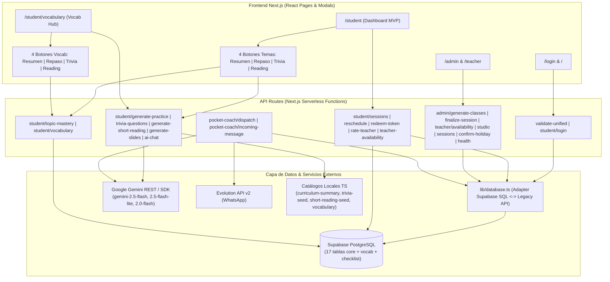

# Auditoría Técnica y Arquitectura de Wiring — LinguaLife MVP

> **Estado:** Auditoría completada, correcciones aplicadas en código y compilación TypeScript verificada (`tsc --noEmit`).  
> **Audiencia:** Dirección de Producto / Socio + Equipo de Ingeniería (Senior Dev Onboarding).

---

## 1. Mapa General de Arquitectura (End-to-End Wiring)

---

## 2. Base de Datos Supabase PostgreSQL y Capa Adaptadora

### 2.1 Adaptador Central: `apps/web/lib/database.ts` (re-exportado por `apps/web/lib/airtable.ts`)
El sistema nació sobre Airtable y migró a Supabase PostgreSQL (`apps/web/lib/supabaseClient.ts`). En lugar de reescribir cada endpoint de golpe, `lib/database.ts` expone las funciones compatibilizadas `fetchFromDB` (`fetchFromAirtable`), `findDBRecords`, `fetchDBRecord`, `createDBRecord`, `patchDBRecord` y `deleteDBRecord`, traduciendo nombres lógicos de tabla, parseando fórmulas tipo Airtable (`filterByFormula`, `FIND`, `ARRAYJOIN`, `RECORD_ID()`, `IS_AFTER`, `IS_BEFORE`, `sort[0]`, `maxRecords`) y normalizando los campos al formato `{ id, fields, createdTime }`.

**Normalización crítica en Postgres (`schema_17_tables.sql`):**
En la migración inicial muchas columnas numéricas o booleanas quedaron tipadas como `TEXT` (`"Tokens de Reposición"`, `"Order"`, `"Is Holiday"`, `"Holiday Confirmed (Teacher)"`, `"Holiday Confirmed (Student)"`, `"Classes Remaining"`). El adaptador `database.ts` ahora:
- Parsea `'Tokens de Reposición'` como entero seguro incluso cuando vale `0`.
- Sincroniza `'Classes Remaining'` ↔ `'ClassesRemaining'` en lectura y escritura (`patchDBRecord`), eliminando el alias virtual antes de enviar el `UPDATE` a SQL (antes enviaba columnas inexistentes causando fallos silenciosos).
- Convierte `'Is Holiday'` string `'false'` / `'true'` a booleano real y convierte `'Order'` numérico a número para evitar comparaciones lexicográficas (`'9' > '10'`).
- Soporta múltiples cláusulas `FIND(...)`, `RECORD_ID() != '...'`, ordenamiento numérico de `Order` y `maxRecords`.

### 2.2 Inventario de Tablas en Supabase

#### A. Esquema Core (17 tablas — `apps/web/scripts/schema_17_tables.sql`)
| Tabla Postgres | Alias Lógico | Rol en el MVP de Alumnos y Operación | Columnas Clave |
| :--- | :--- | :--- | :--- |
| `students` | `Students` | Perfil de estudiante, PIN de acceso, créditos, progreso serializado en `Notes` | `"Full Name"`, `"Email"`, `"Phone"`, `"PIN"`, `"Status"`, `"Tokens de Reposición"`, `"Current Topic (Bot)"`, `"Pocket Coach Status"`, `"Interests"`, `"Availability"`, `"Notes"`, (`"Classes Remaining"` si migrada) |
| `teachers` | `Teachers` | Perfil del profesor, PIN, link de videollamada, matriz semanal de disponibilidad | `"Name"`, `"Email"`, `"Phone"`, `"PIN"`, `"Meeting Link"`, `"Availability"`, `"Timezone"`, `"SS Expiry Date"`, `"Status"` |
| `student_teacher` | `Student-Teacher` | Vínculo Alumno(s)–Profesor, días/hora recurrentes y notas de relación | `"Student"`, `"Teacher"`, `"Status"`, `"Recurrence Day"`, `"Recurrence Time"`, `"Start Date"`, `"Notes"` |
| `sessions` | `Sessions` | Clases programadas (`Scheduled`), vistas (`Seen`), canceladas (`Canceled`) y festivos | `"Session Name"`, `"Teacher"`, `"Curriculum Topic"`, `"Scheduled Date/Time"`, `"Duration (minutes)"`, `"Location/Link"`, `"Status"`, `"Extraordinary Session (Token)"`, `"Is Holiday"`, `"Holiday Confirmed (Teacher)"`, `"Holiday Confirmed (Student)"` |
| `session_participants` | `Session Participants` | Tabla puente Sesión ↔ Estudiante y observaciones del profesor | `"Session"`, `"Student"`, `"Attendance"`, `"Teacher Observations"`, `"Feedback (for student)"`, `"Curriculum Topic"` |
| `curriculum_topics` | `Curriculum Topics` | Catálogo de 60 temas del programa con orden, fórmula y slides cacheadas | `"Topic Name"`, `"Curriculum"`, `"Order"`, `"Level"`, `"LDS_Formula"`, `"AI_Context"`, `"Fase"`, `"Cached Slides"`, `"Cached Warmup"`, `"Cached Cooldown"` |
| `curriculums` | `Curriculums` | Programas académicos (ej. `General English Course`) | `"Curriculum Name"`, `"Vertical"`, `"Status"` |
| `student_topic_progress` | `Student Topic Progress` | Rango de platinado por tema (`Bronze`..`Platinum`) **+ fallback de triage vocab (`vocab_<senseId>`)** | `"Student + Topic"`, `"Student"`, `"Curriculum Topic"`, `"Status"`, `"Completed At"`, `"Notes"` |
| `study_groups` | `Study Groups` | Grupos de estudio (ej. Comunidad / Conocidos) | `"Group Name"`, `"Group Type"`, `"Students"`, `"Primary Teacher"`, `"Status"` |
| `error_patterns` | `Error Patterns` | Registro de errores gramaticales observados al finalizar sesión | `"Error Pattern"`, `"Description"`, `"Category"`, `"Active?"`, `"Session Participants"` |
| `series_requests` | `Series Requests` | Solicitudes de series/contenido | `"Series Name"`, `"Student"`, `"Status"`, `"Student ID"` |
| `video_bank` | `Video Bank` | Banco de videos clasificados por nivel | `"Title"`, `"YouTube URL"`, `"Level"`, `"Vertical"`, `"Status"` |
| `curated_ops` (resto) | — | Tablas auxiliares del ecosistema | `interests`, `progress_apply_queue`, `student_curriculum`, `teacher_availability`, `verticals` |

#### B. Esquema Vocabulario CEFR & Red Semántica (`apps/web/scripts/vocabulary_schema.sql`)
| Tabla Postgres | Estado / Propósito | Fallback Activo |
| :--- | :--- | :--- |
| `vocabulary_words` | Lema + nivel CEFR (`A1`..`C2`) + categoría gramatical e IPA | Si no está sembrada, se lee del catálogo maestro `apps/web/lib/vocabulary.ts` |
| `vocabulary_senses` | Acepciones individuales polisémicas con ejemplos y colocaciones | Catálogo local `VOCABULARY_MASTER_DATA` |
| `vocabulary_relations` | Grafo de sinónimos, antónimos y términos relacionados | Relaciones locales embebidas en `vocabulary.ts` |
| `student_vocabulary_state` | Triage por acepción (`unreviewed`, `to_learn`, `passive`, `mastered`) | **Fallback automático en `api/student/vocabulary.ts`:** si `student_vocabulary_state` falla (o el `sense_id` es slug textual en lugar de UUID), lee y escribe en `student_topic_progress` con clave `Curriculum Topic = "vocab_<senseId>"`, más caché local en `localStorage` |
| `vocabulary_game_sessions` | Esquema preparado para métricas históricas de juegos (`trivia`, `speed_linker`) | Estado actual de juego en cliente y persistencia de triage |

#### C. Tablas Operativas Adicionales
- `public.sprint_checklist_state`: Persistencia colaborativa en vivo de `/checklist`.
- `public.teacher_reviews` (opcional): Si existe, `api/student/rate-teacher.ts` inserta ahí; si no existe, guarda de forma transparente un JSON estructurado (`=== TEACHER_REVIEWS_JSON ===`) dentro de `student_teacher.Notes` (o `students.Notes`).

---

## 3. Flujo Administrativo, Login y Gestión de Clases (Endpoints y Wiring)

| Flujo UI / Endpoint | Archivo | Tablas Tocadas | Reglas de Negocio & Comportamiento |
| :--- | :--- | :--- | :--- |
| **Login Unificado PIN** | [`pages/api/validate-unified.ts`](file:///c:/Users/Usuario/Documents/Antigravity/LinguaLife/apps/web/pages/api/validate-unified.ts) | `teachers`, `students`, `student_teacher` | Valida PIN exacto (trimmed). Resuelve profesor activo en `student_teacher` vía `.ilike('Student', ...)` (soporta grupos/parejas). Guarda sesión en `sessionStorage.ll_student`. |
| **Login Email + PIN** | [`pages/api/student/login.ts`](file:///c:/Users/Usuario/Documents/Antigravity/LinguaLife/apps/web/pages/api/student/login.ts) | `students`, `student_teacher`, `teachers` | Búsqueda insensible a mayúsculas por Email + verificación exacta de PIN + resolución de profesor. |
| **Generación de Clases (Admin)** | [`pages/api/admin/generate-classes.ts`](file:///c:/Users/Usuario/Documents/Antigravity/LinguaLife/apps/web/pages/api/admin/generate-classes.ts) | `study_groups`, `teachers`, `students`, `curriculum_topics`, `sessions`, `session_participants` | Lee matriz semanal (lun–dom, 6am–8pm COT), detecta festivos colombianos (`lib/holidays.ts`), ordena los temas del `General English Course` numéricamente por `Order` y genera las sesiones + participantes en Supabase. |
| **Finalizar Sesión (Profesor)** | [`pages/api/finalize-session.ts`](file:///c:/Users/Usuario/Documents/Antigravity/LinguaLife/apps/web/pages/api/finalize-session.ts) | `sessions`, `students`, `curriculum_topics`, `session_participants`, `error_patterns` | Marca sesión como `Seen`, descuenta 1 crédito de `Classes Remaining`, avanza `Current Topic (Bot)` al `Order + 1`, registra `Error Patterns` y dispara alerta WhatsApp vía `EvolutionAPI` si quedan `<= 2` clases. |
| **Carga de Dashboard (`/student`)** | [`pages/api/student/sessions.ts`](file:///c:/Users/Usuario/Documents/Antigravity/LinguaLife/apps/web/pages/api/student/sessions.ts) | `students`, `session_participants`, `sessions`, `student_teacher`, `teachers`, `curriculum_topics`, `student_topic_progress` | Separa `upcoming` (`Scheduled` o festivos) y `completed` (`Seen`). Resuelve nombres/órdenes de tema (incluyendo IDs legacy como `recTopic7` usando `getTopicSummary`), infiere horario recurrente en COT si falta y unifica `masteryMap` (`student_topic_progress` + JSON en `students.Notes`). |
| **Reagendar (+24h → +1 Token)** | [`pages/api/student/reschedule.ts`](file:///c:/Users/Usuario/Documents/Antigravity/LinguaLife/apps/web/pages/api/student/reschedule.ts) | `sessions`, `session_participants`, `students`, `teachers` | Exige `Status === 'Scheduled'` y `>= 24h` de anticipación. Cancela la clase, **recorre en cascada** los `Curriculum Topic` de todas las sesiones futuras programadas del alumno para no perder el orden del temario, suma `+1` entero a `Tokens de Reposición` y notifica vía WhatsApp/Email (`lib/notify.ts`). |
| **Disponibilidad Docente** | [`pages/api/student/teacher-availability.ts`](file:///c:/Users/Usuario/Documents/Antigravity/LinguaLife/apps/web/pages/api/student/teacher-availability.ts) | `teachers`, `sessions` | Devuelve la matriz `availability: boolean[][]` y `bookedDates: string[]` (bloques ya reservados en futuro) para ocultar horarios ocupados en el calendario de redención. |
| **Redimir Token** | [`pages/api/student/redeem-token.ts`](file:///c:/Users/Usuario/Documents/Antigravity/LinguaLife/apps/web/pages/api/student/redeem-token.ts) | `students`, `student_teacher`, `teachers`, `sessions`, `session_participants`, `curriculum_topics` | Valida tokens `> 0` (para todo el grupo si aplica), anticipación `>= 24h`, disponibilidad del docente y ausencia de conflicto horario (`< 50 min` → HTTP 409). Asigna el siguiente tema tras el máximo visto/programado, crea la sesión y descuenta `1` token. |
| **Calificar Profesor** | [`pages/api/student/rate-teacher.ts`](file:///c:/Users/Usuario/Documents/Antigravity/LinguaLife/apps/web/pages/api/student/rate-teacher.ts) | `teacher_reviews` / `student_teacher` / `students` | Intenta insertar en `teacher_reviews`; si no existe la tabla en Supabase, guarda el JSON estructurado en `student_teacher.Notes` (o `students.Notes`) devolviendo HTTP 200 sin pérdida de datos. |

---

## 4. Sistema de los "4 Botones" (Temas Vistos y Gimnasio de Vocabulario)

### 4.1 Los 4 Botones en Temas Vistos (`apps/web/pages/student.tsx`)

| Botón | Origen de Datos / API | Modelo IA & Configuración | Caché, Límites y Respaldo (Fallback) |
| :--- | :--- | :--- | :--- |
| **1. Resumen** | `getTopicSummary(order, name)` en [`lib/curriculum-summary.ts`](file:///c:/Users/Usuario/Documents/Antigravity/LinguaLife/apps/web/lib/curriculum-summary.ts) + `cachedSlides` desde `sessions.ts` | Determinista (sin llamada IA en vivo; `$0` costo y latencia `0ms`) | Catálogo completo para los 60 temas (`CURRICULUM_SUMMARY_CATALOG`) con bloque conceptual, método correcto, 2+ ejemplos bilingües y "Colombian Trap". Al abrir, marca Bronze mínimo vía `/api/student/topic-mastery` si estaba en Tier 0. |
| **2. Repaso** | `POST /api/student/generate-practice` ([`generate-practice.ts`](file:///c:/Users/Usuario/Documents/Antigravity/LinguaLife/apps/web/pages/api/student/generate-practice.ts)) | **Gemini:** cascada `gemini-2.5-flash` → `gemini-2.5-flash-lite` → `gemini-2.0-flash` (`temperature: 0.3`, `maxOutputTokens: 2500`) | Prompt exige exactamente 15 ítems en JSON (`5 Fill the Pattern`, `5 Spot the Colombian Trap`, `5 Reverse Sprint`) y prohíbe revelar la palabra faltante tras `[___]`. Caché cliente en `sessionStorage` + `localStorage` (`ll_practice_v2_<studentId>_<order>`). Rate limit local: 3 guías nuevas cada 12h. Si Gemini falla u offline: `buildTopicPracticeFallback` genera una guía de 15 ítems derivada dinámicamente del tema exacto (`topicOrder`). |
| **3. Trivia Infinita** | [`InfiniteTriviaModal.tsx`](file:///c:/Users/Usuario/Documents/Antigravity/LinguaLife/apps/web/components/InfiniteTriviaModal.tsx) + [`trivia-seed.ts`](file:///c:/Users/Usuario/Documents/Antigravity/LinguaLife/apps/web/lib/trivia-seed.ts) + `POST /api/student/trivia-questions` | **Gemini:** `gemini-2.5-flash` → `gemini-2.5-flash-lite` → `gemini-2.0-flash` (`temperature: 0.8`, `maxOutputTokens: 2500`) | Pool inicial instantáneo (`getSeedQuestionsForTopic` + banco AI guardado en `localStorage`). Refill asíncrono en background cuando quedan `<= 4` preguntas en cola, solicitando 5 arquetipos distintos (`situation`, `spot_trap`, `cloze`, `transform`, `detective`) y excluyendo las últimas 15 preguntas (`excludeContexts`). Escala automáticamente de dificultad (`basic` → `intermediate` en racha `>= 5` → `advanced` en racha `>= 10`) y promueve rango de platinado en `topic-mastery.ts` (`5=Bronze`, `10=Silver`, `15=Gold`, `20=Diamond`, `25=Platinum`). Efectos Web Audio (`sound-effects.ts`). Si falla la API: `buildSeedFallbackBatch` genera lotes frescos de respaldo sin bloquear el bucle. |
| **4. Short Reading** | [`ShortReadingModal.tsx`](file:///c:/Users/Usuario/Documents/Antigravity/LinguaLife/apps/web/components/ShortReadingModal.tsx) + [`short-reading-seed.ts`](file:///c:/Users/Usuario/Documents/Antigravity/LinguaLife/apps/web/lib/short-reading-seed.ts) + `POST /api/student/generate-short-reading` | **Gemini:** `gemini-2.5-flash` → `gemini-2.5-flash-lite` → `gemini-2.0-flash` (`temperature: 0.4`, `maxOutputTokens: 600`) | Carga inicial con `forceNew: false` desde inventario semilla (`Costo $0`) y caché en `sessionStorage` (`ll_short_reading_<order>`). Botón **"Nueva versión con IA"** (`forceNew: true`, límite local 3 por hora/tema) exige micro-historia `< 100 palabras` con pregunta de comprensión. Audio nativo `window.speechSynthesis` (velocidad ajustable) y `soundEngine.playRewardChime()` al acertar el micro-check. |

### 4.2 Los 4 Botones y Pestañas en Gimnasio de Vocabulario (`apps/web/pages/student/vocabulary.tsx`)

El hub carga el perfil activo desde `sessionStorage.ll_student`, selecciona categoría (`time_words` [13], `prepositions_in_on_at`, `wh_words`, `cefr_general`) y nivel MCER (`A1`–`C2`, con toggle `includePreviousPending`), y sincroniza estados desde `/api/student/vocabulary`. Soporta deep links directos `?mode=resumen|repaso|trivia|reading`.

| Modo / Pestaña | Componente | Mecánica y Conexión de Datos |
| :--- | :--- | :--- |
| **1. Resumen (Modal)** | [`VocabResumenModal.tsx`](file:///c:/Users/Usuario/Documents/Antigravity/LinguaLife/apps/web/components/vocabulary/VocabResumenModal.tsx) | Selector horizontal de palabras de la categoría/nivel actual, acepciones múltiples polisémicas (`senses`), pronunciación Web Speech API, colocaciones, notas pedagógicas y red de sinónimos/antónimos (`relations`). |
| **2. Repaso (Modal)** | [`VocabRepasoModal.tsx`](file:///c:/Users/Usuario/Documents/Antigravity/LinguaLife/apps/web/components/vocabulary/VocabRepasoModal.tsx) | Gimnasia mental determinista generada con `getVocabMentalGymExercises(words, level)` en [`lib/vocabulary.ts`](file:///c:/Users/Usuario/Documents/Antigravity/LinguaLife/apps/web/lib/vocabulary.ts): flashcards de acepciones y contraste contextual, con `playRewardChime()`. |
| **3. Trivia Activa (Tab / ?mode=trivia)** | [`VocabularyTrivia.tsx`](file:///c:/Users/Usuario/Documents/Antigravity/LinguaLife/apps/web/components/vocabulary/VocabularyTrivia.tsx) | Misma arquitectura de bucle infinito sin congelamiento (`queueRef`), pool inicial desde `getSeedQuestionsForVocabulary(category, level, words)` + banco persistente en `localStorage`, refill asíncrono contra `POST /api/student/trivia-questions` con `contextType: 'vocabulary'`, niveles dinámicos y combos sonoros. |
| **4. Short Reading (Modal)** | [`VocabReadingModal.tsx`](file:///c:/Users/Usuario/Documents/Antigravity/LinguaLife/apps/web/components/vocabulary/VocabReadingModal.tsx) | Lectura breve por categoría/nivel (`getVocabShortReadingByLevel(category, level)` en `lib/vocabulary.ts`) con control de velocidad TTS (`0.7x` / `0.9x` / `1.0x`), pregunta de comprensión y chime al acertar. |
| **Pestaña Mi Inventario** | [`VocabularyGridManager.tsx`](file:///c:/Users/Usuario/Documents/Antigravity/LinguaLife/apps/web/components/vocabulary/VocabularyGridManager.tsx) | Grid filtrable (`Por Aprender`, `Pasiva`, `Dominada`, `Sin revisar`). Al hacer clic cicla estado, actualiza `localStorage` y dispara `POST /api/student/vocabulary` → `student_vocabulary_state` / `student_topic_progress`. Sincroniza su mapa local reactivamente cada vez que cambia `words`. |
| **Pestaña Clasificar (Swiper)** | [`VocabularySwiper.tsx`](file:///c:/Users/Usuario/Documents/Antigravity/LinguaLife/apps/web/components/vocabulary/VocabularySwiper.tsx) | Clasificación rápida tarjeta por tarjeta (con Undo), conectado a `handleWordStatusChanged` para persistir inmediatamente en Supabase y reiniciar índice limpiamente solo al cambiar categoría o nivel. |
| **Pestaña Conector Semántico** | [`SpeedLinker.tsx`](file:///c:/Users/Usuario/Documents/Antigravity/LinguaLife/apps/web/components/vocabulary/SpeedLinker.tsx) | Juego de velocidad de 45s que construye pares dinámicamente desde las `relations` (sinónimos/antónimos) y `definitionEs` del banco `words` activo (sin quedarse fijo en 6 palabras estáticas), con puntaje por combo y feedback sonoro. |

---

## 5. Otros Servicios IA y Prompts del Ecosistema

| Endpoint | Modelo(s) | Configuración & Prompt | Observaciones |
| :--- | :--- | :--- | :--- |
| **`generate-slides.ts`** | `gemini-2.5-flash` → `gemini-2.5-flash-lite` → `gemini-2.0-flash` | Genera 4 bloques de diapositiva HTML dark-mode (`Logic Decoder`, `Colombian Filter`, `Real-Life Chunks`, `Conversation & News`) + JSON `WARMUP_ASSETS` y `COOLDOWN_ASSETS`. Prohíbe jerga matemática ("LDS", "S+T+A"). | Incluye fallback determinista para nunca devolver HTTP 502 si la clave o red fallan. |
| **`ai-chat.ts` (Copilot Docente)** | `gemini-2.5-flash-lite` | `systemInstruction` en español adaptado al alumno/nivel/tema actual. Si falta `GEMINI_API_KEY` devuelve mensaje amigable HTTP 200. | Usado en la vista del profesor durante clase en vivo. |
| **`pocket-coach/dispatch.ts` & `incoming-message.ts`** | SDK `@google/generative-ai`: `gemini-3.1-flash-lite` → `gemini-3.5-flash-lite` → `gemini-flash-lite-latest` → `gemini-3.5-flash` | Guardrails estrictos (`lib/pocket-coach/prompt-engine.ts`): solo primer nombre de pila, mensajes concisos `< 400 chars` (WhatsApp vía Evolution API), cero mención de llamadas o acrónimo LDS, y *Human Handoff* inmediato si detecta palabras administrativas/pagos (`nequi`, `bancolombia`, `horario`, `factura`, etc.). Dispatch: `temp: 0.85, maxOutputTokens: 400`. Chat: `temp: 0.75, maxOutputTokens: 250`, hilo en memoria RAM últimos 4 mensajes truncados a 140 chars. | Los cron/webhooks protegen reputación de WhatsApp ignorando `@g.us`/broadcasts y usando jitter aleatorio entre envíos masivos. |

---

## 6. Resumen de Correcciones Aplicadas en Esta Auditoría

1. **Adaptador Supabase (`lib/database.ts`)**: Parseo real de booleanos `'false'`/`'true'`, tokens `0`, sincronización `Classes Remaining` / `ClassesRemaining`, limpieza de alias virtuales antes de ejecutar SQL `UPDATE`, soporte de `RECORD_ID() !=`, múltiples `FIND(...)`, `IS_AFTER`/`IS_BEFORE` y ordenamiento numérico de `Order`.
2. **Eliminación de dependencias Airtable residuales**: Migrados `admin/generate-classes.ts` (además corrige ordenamiento numérico de los 60 temas), `teacher/availability.ts`, `finalize-session.ts`, `health.ts` y `video-bank-random.ts` a Supabase/`@/lib/database`.
3. **Blindaje de Flujos Administrativos de Alumnos**:
   - `validate-unified.ts` & `student/login.ts`: Búsqueda robusta de vínculos grupales en `student_teacher`.
   - `student/sessions.ts`: Resolución segura de IDs legacy como `recTopic7`, eliminación de horarios hardcodeados (`'Mie,Vie'`, `'11:00 AM'`, fallback `2` clases), inferencia automática desde sesiones activas y parseo multi-marcador de `students.Notes`.
   - `student/reschedule.ts`: Regla real de **24h** unificada con términos/UI, bloqueo de doble cancelación sobre la misma clase, aritmética entera en tokens (`'1' + 1` → `2` en vez de `'11'`) y cascada real vía `session_participants`.
   - `student/redeem-token.ts` & `student/teacher-availability.ts`: Detección y bloqueo de colisión de horarios ya reservados (`bookedDates` + HTTP 409) y cálculo exacto del próximo tema por alumno.
   - `student/rate-teacher.ts` & `student/topic-mastery.ts`: Persistencia garantizada de calificaciones sin HTTP 500 y preservación íntegra de múltiples secciones JSON en `students.Notes`.
4. **Pulido UX e IA en `/student`, `/student/vocabulary` y los 4 Botones**:
   - Reemplazados todos los `alert()` bloqueantes en `/student` y `ShortReadingModal` por banners/toasts inline, y eliminados textos estáticos `"Mes 1"`, `"(Cierre próx. Miércoles)"` y `"Tip de Santiago"`.
   - `generate-practice.ts` ahora recibe `topicOrder`, `level`, `ldsFormula` y `commonMistake` y construye su fallback con el tema específico del alumno.
   - `vocabulary.tsx`: Lee la sesión activa correcta (`sessionStorage.ll_student`), conecta el `VocabularySwiper` a `handleWordStatusChanged` para persistir en Supabase, sincroniza `VocabularyGridManager` y `VocabResumenModal` al cambiar nivel/categoría, y dinamiza `SpeedLinker` usando relaciones reales de `words` con audio chime al acertar.
   - `curriculum-summary.ts` & `ShortReadingModal.tsx`: Eliminado LaTeX literal `$\rightarrow$`, mejorados textos de ejemplo/error en Temas 56–60, y añadido feedback sonoro al responder correctamente.
